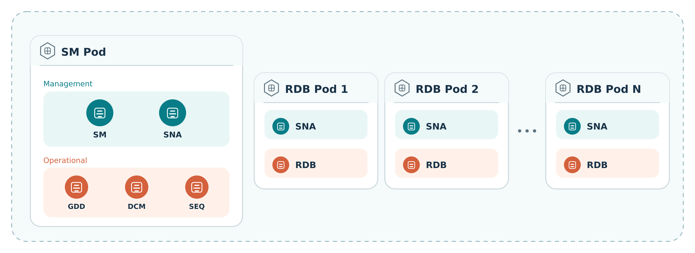
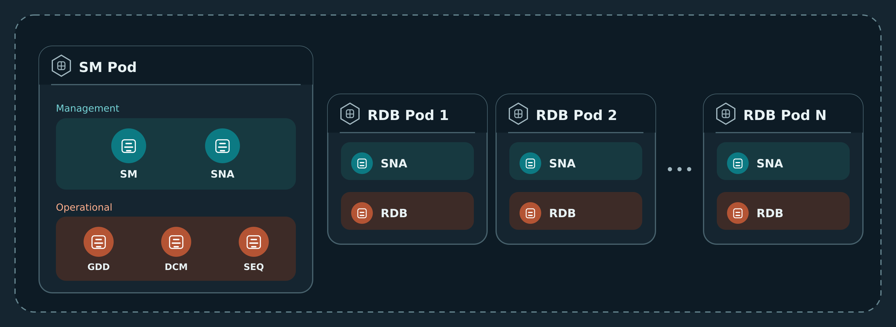

<Note>
  This section assumes you're already familiar with the [RegattaDB software modules](/self-hosted-deployment/manual-deployment/regattadb-software-modules) (SM, SNA, GDD, DCM, Sequencer, RDB) and how they work together in a RegattaDB deployment.
</Note>

The **Regatta operator** is a Kubernetes controller that automates deploying and operating RegattaDB on Kubernetes. Instead of manually creating the Kubernetes resources RegattaDB needs, provisioning its storage, and issuing System Manager (SM) commands yourself, you describe the RegattaDB deployment you want in a single `RegattaCluster` resource and let the operator drive Kubernetes and RegattaDB into that state.

## Kubernetes Concepts You Will Use

| Concept | What it means for this section |
| --- | --- |
| [Pod](https://kubernetes.io/docs/concepts/workloads/pods/) | Where one or more RegattaDB modules run together; see [Deployment Architecture](#deployment-architecture) below |
| [Kubernetes node](https://kubernetes.io/docs/concepts/architecture/nodes/) | A physical or virtual machine that can run Pods. Kubernetes places Pods on nodes automatically |
| [StatefulSet](https://kubernetes.io/docs/concepts/workloads/controllers/statefulset/) | Keeps a fixed, ordered set of Pods running with stable identities and their own storage. The operator creates one StatefulSet per Pod group in the selected layout |
| [Service](https://kubernetes.io/docs/concepts/services-networking/service/) | A stable network name and address for one or more Pods, even as Pods restart or move between Kubernetes nodes |
| [`PersistentVolumeClaim` (PVC)](https://kubernetes.io/docs/concepts/storage/persistent-volumes/#persistentvolumeclaims) | A request for storage that Kubernetes binds to an actual storage volume or device |
| [Raw block volume](https://kubernetes.io/docs/concepts/storage/persistent-volumes/#raw-block-volume-support) | A storage device given to a Pod directly, the same way you would give RegattaDB a raw block device in a manual deployment, without a filesystem in between |
| [CustomResourceDefinition (CRD)](https://kubernetes.io/docs/concepts/extend-kubernetes/api-extension/custom-resources/) | Registers `RegattaCluster` (full name `regattaclusters.regatta.dev`, short names `regatta`/`rgc`, usable in place of `regattacluster` in `kubectl`) as a Kubernetes resource type, so Kubernetes can store, validate, and let the operator watch it |
| [`spec`](https://kubernetes.io/docs/concepts/overview/working-with-objects/#object-spec-and-status) | The part of your `RegattaCluster` resource where you write the state you want; only you (and the operator's own defaults) ever set it |
| [`status`](https://kubernetes.io/docs/concepts/overview/working-with-objects/#object-spec-and-status) | The part of your `RegattaCluster` resource where the operator reports the state it observed; never edit it yourself |
| [Operator](https://kubernetes.io/docs/concepts/extend-kubernetes/operator/) | The program that continuously watches your `RegattaCluster` resource and keeps Kubernetes and RegattaDB matching it |

## What the operator does for you

- **Describes your deployment as a single Kubernetes resource**: the `RegattaCluster` resource captures the RegattaDB image, Pod layout, module settings, storage, and resource sizing you want.
- **Creates and maintains the Kubernetes resources RegattaDB needs**: StatefulSets, Services, ConfigMaps, and storage claims, generated and kept in sync automatically.
- **Configures and starts RegattaDB for you**: once Kubernetes resources are ready, the operator configures RegattaDB modules and starts or stops RegattaDB through the System Manager (SM).
- **Reports readiness continuously**: Kubernetes and RegattaDB health are reflected in the `RegattaCluster` status, so you always know the current state.

## Deployment Architecture

In a manual or RDT-driven RegattaDB deployment, you decide which node runs which modules: one SM, one SNA on every node that hosts an operational module, one GDD, one DCM, one Sequencer, and one or more RDB modules. On Kubernetes, a **Pod** is the unit that runs one or more RegattaDB modules together, the same role a node plays in a manual deployment. You select a layout with `spec.layout`, and the operator places the modules for you:

| Layout | Pod groups | When to use it |
| --- | --- | --- |
| `Legacy` (default) | `sm` runs SM, SNA, GDD, DCM, and Sequencer; `rdb` runs SNA and RDB | Keep the shared management Pod and separate RDB Pods |
| `Distributed` | `sm` runs SM alone; `dcm`, `gdd`, `sequencer`, and `rdb` each run their named module with SNA | Size or schedule the modules independently |
| `AllInOne` | `all` runs SM, SNA, GDD, DCM, Sequencer, and RDB together | Run the entire system in one Pod with one RDB replica |

Each group runs one Pod, except the `rdb` group, which runs one Pod per RDB replica. The diagram below shows the default `Legacy` placement.

<Frame>
  
  
</Frame>

Unlike a manual deployment, you choose one of the supported layouts rather than assigning individual modules to Pods. Choose the layout and RDB replica count before creating the cluster; neither can be changed afterward.

Each Pod gets its own stable Kubernetes Service. The operator also creates a stable SM Service and a shared client Service for all Pods that run RDB, regardless of the selected layout. See [Networking](/self-hosted-deployment/kubernetes/configuration/networking) for Service names and ports.

A **Kubernetes node** is a physical or virtual machine in your Kubernetes cluster. It is a different concept from the node used in manual RegattaDB deployment guides: a single Kubernetes node can run many Pods at once, including Pods belonging to other applications, and Kubernetes decides which node each Pod runs on and can move a Pod to a different node later. You do not assign RegattaDB modules to specific Kubernetes nodes yourself, though you can influence which Kubernetes nodes the operator's Pods are eligible to run on using standard scheduling controls; see [Schedule Pods](/self-hosted-deployment/kubernetes/configuration/resources-and-scheduling#schedule-pods).

## How this section is organized

- **[Prerequisites](/self-hosted-deployment/kubernetes/prerequisites)** and **[Installation](/self-hosted-deployment/kubernetes/installation)**: what your cluster needs, and how to install the operator.
- [**Configuration**](/self-hosted-deployment/kubernetes/configuration/overview): the `RegattaCluster` spec reference, covering the object header, image, layout, module settings, storage, networking, security and lifecycle, and resources and scheduling.
- [**Examples**](/self-hosted-deployment/kubernetes/examples/quickstart-single-node): end-to-end walkthroughs, from a single-node quickstart to static RDB storage.
- [**Operations**](/self-hosted-deployment/kubernetes/operations): how the operator keeps Kubernetes and RegattaDB in sync, reading status, and making supported changes.
- [**Troubleshooting**](/self-hosted-deployment/kubernetes/troubleshooting) and [**Release Notes**](/self-hosted-deployment/kubernetes/release-notes).

## Next steps

New to the Regatta operator? Start with [Prerequisites](/self-hosted-deployment/kubernetes/prerequisites) and
[Installation](/self-hosted-deployment/kubernetes/installation), then follow the
[Quickstart: Single-Node RegattaCluster](/self-hosted-deployment/kubernetes/examples/quickstart-single-node)
to deploy RegattaDB end to end.
